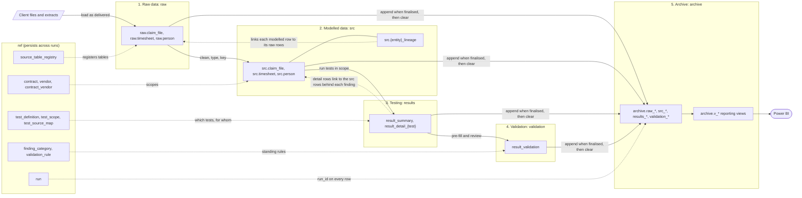

# 00 Process flow

How a run moves data through the five stages. Each box is a schema. `ref` persists across runs; `raw`, `src`, `results` and `validation` hold the current run only and are cleared once it is archived. For the data model growing stage by stage, see [lifecycle/](lifecycle/).

| Stage | Reads | Writes | Run status |
| --- | --- | --- | --- |
| 1. Raw data | Client files | `raw` | `loading` |
| 2. Modelled data | `raw`, `ref` | `src`, including lineage | `loading` |
| 3. Testing | `src`, `ref.test_scope` | `results` | `testing` |
| 4. Validation | `results`, `ref.validation_rule` | `validation` | `validating` |
| 5. Archive | `raw`, `src`, `results`, `validation` | `archive` | `finalised` |

The reporting views union the live tables with their archive copies, so Power BI sees the in-flight run and every finalised one.

[Back to the README](../README.md)
