# 01 Data model

Every table in every schema, with all relationships. Archive tables are shown without columns: each has the same columns as its live table plus `archived_at` (see [07 Archive](07-archive.md)).

```mermaid
erDiagram
  REF_CONTRACT ||--o{ REF_CONTRACT_VENDOR : "engages"
  REF_VENDOR ||--o{ REF_CONTRACT_VENDOR : "engaged on"
  REF_TEST_DEFINITION ||--o{ REF_TEST_SOURCE_MAP : "reads"
  REF_SOURCE_TABLE_REGISTRY ||--o{ REF_TEST_SOURCE_MAP : "read by"
  REF_TEST_DEFINITION ||--o{ REF_TEST_SCOPE : "scoped to"
  REF_CONTRACT_VENDOR ||--o{ REF_TEST_SCOPE : "tested by"
  REF_TEST_DEFINITION ||--o{ REF_VALIDATION_RULE : "for test"
  REF_CONTRACT_VENDOR ||--o{ REF_VALIDATION_RULE : "for vendor on contract"
  REF_FINDING_CATEGORY ||--o{ REF_VALIDATION_RULE : "for category"
  REF_RUN ||--o{ RAW_SOURCE : "loads"
  REF_RUN ||--o{ SRC_PERSON : "models"
  REF_RUN ||--o{ SRC_TIMESHEET : "models"
  REF_RUN ||--o{ SRC_CLAIM_FILE : "models"
  REF_VENDOR ||--o{ SRC_PERSON : "employs"
  SRC_PERSON ||--o{ SRC_TIMESHEET : "works"
  SRC_PERSON |o--o{ SRC_CLAIM_FILE : "claimed for"
  REF_CONTRACT_VENDOR ||--o{ SRC_TIMESHEET : "worked under"
  REF_CONTRACT_VENDOR ||--o{ SRC_CLAIM_FILE : "claimed under"
  REF_RUN ||--o{ RES_RESULT_SUMMARY : "produces"
  REF_TEST_DEFINITION ||--o{ RES_RESULT_SUMMARY : "generates"
  REF_CONTRACT_VENDOR ||--o{ RES_RESULT_SUMMARY : "found on"
  REF_FINDING_CATEGORY |o--o{ RES_RESULT_SUMMARY : "auto-tagged as"
  RES_RESULT_SUMMARY ||--o{ RES_RESULT_DETAIL : "drill-through"
  REF_RUN ||--o{ RES_RESULT_DETAIL : "produces"
  RES_RESULT_SUMMARY ||--o| VAL_RESULT_VALIDATION : "validated by"
  REF_VALIDATION_RULE |o--o{ VAL_RESULT_VALIDATION : "pre-fills"
  REF_FINDING_CATEGORY |o--o{ VAL_RESULT_VALIDATION : "classified as"
  REF_RUN ||--o{ VAL_RESULT_VALIDATION : "reviews"
  REF_RUN ||--o{ ARC_RAW_SOURCE : "archived"
  REF_RUN ||--o{ ARC_SRC_PERSON : "archived"
  REF_RUN ||--o{ ARC_SRC_TIMESHEET : "archived"
  REF_RUN ||--o{ ARC_SRC_CLAIM_FILE : "archived"
  REF_RUN ||--o{ ARC_RES_RESULT_SUMMARY : "archived"
  REF_RUN ||--o{ ARC_RES_RESULT_DETAIL : "archived"
  REF_RUN ||--o{ ARC_VAL_RESULT_VALIDATION : "archived"
  ARC_RES_RESULT_SUMMARY ||--o{ ARC_RES_RESULT_DETAIL : "drill-through"
  ARC_RES_RESULT_SUMMARY ||--o| ARC_VAL_RESULT_VALIDATION : "validated by"

  REF_RUN["ref.run"] {
    int run_id PK
    date period_start
    date period_end
    date run_date
    string status "loading | testing | validating | finalised"
  }
  REF_CONTRACT["ref.contract"] {
    int contract_id PK
    string contract_number "natural key"
    string contract_name
    date start_date
    date end_date
    string status
  }
  REF_VENDOR["ref.vendor"] {
    int vendor_id PK
    string vendor_number "natural key"
    string vendor_name
    string abn
  }
  REF_CONTRACT_VENDOR["ref.contract_vendor"] {
    int contract_vendor_id PK
    int contract_id FK
    int vendor_id FK
    date start_date
    date end_date
  }
  REF_SOURCE_TABLE_REGISTRY["ref.source_table_registry"] {
    int source_table_id PK
    string schema_name "raw | src | results | validation"
    string table_name
    string description
  }
  REF_TEST_DEFINITION["ref.test_definition"] {
    int test_id PK
    string test_name
    string test_description
    string test_logic_ref "SP or script name"
    string detail_table "results.result_detail_{test}"
    string owner
  }
  REF_TEST_SOURCE_MAP["ref.test_source_map"] {
    int test_id FK
    int source_table_id FK
  }
  REF_TEST_SCOPE["ref.test_scope"] {
    int test_scope_id PK
    int test_id FK
    int contract_vendor_id FK
    date active_from
    date active_to
  }
  REF_FINDING_CATEGORY["ref.finding_category"] {
    int category_id PK
    string category_name
    string description
  }
  REF_VALIDATION_RULE["ref.validation_rule"] {
    int validation_rule_id PK
    int test_id FK
    int contract_vendor_id FK
    int category_id FK
    string disposition
    string explanation
    date effective_from
    date effective_to
  }
  RAW_SOURCE["raw.{source}"] {
    int raw_row_id PK
    int run_id FK
    string source_file
    datetime loaded_at
    string source_columns "as delivered, all text"
  }
  SRC_PERSON["src.person"] {
    int person_id PK
    int run_id FK
    string person_key "natural key"
    int vendor_id FK "vendor they work for"
    string full_name
    string role
    date start_date
    date end_date
  }
  SRC_TIMESHEET["src.timesheet"] {
    int timesheet_id PK
    int run_id FK
    string timesheet_key "natural key"
    int person_id FK
    int contract_vendor_id FK
    date work_date
    decimal hours
    string approval_status
    string approved_by
  }
  SRC_CLAIM_FILE["src.claim_file"] {
    int claim_line_id PK
    int run_id FK
    string claim_number
    string claim_line_key "natural key"
    int contract_vendor_id FK
    int person_id FK "null if not in src.person"
    date work_date
    decimal hours
    decimal rate
    decimal amount "as submitted"
    date submitted_date
  }
  RES_RESULT_SUMMARY["results.result_summary"] {
    int result_id PK
    int run_id FK
    int test_id FK
    int contract_vendor_id FK
    int category_id FK "auto-tag, nullable"
    string record_key "source row the finding is about"
    string description
  }
  RES_RESULT_DETAIL["results.result_detail_{test}"] {
    int detail_id PK
    int run_id FK
    int result_id FK
    string test_columns "test-specific columns"
  }
  VAL_RESULT_VALIDATION["validation.result_validation"] {
    int result_validation_id PK
    int run_id FK
    int result_id FK "one per finding"
    int validation_rule_id FK "null = set by hand"
    int category_id FK "final category, null until reviewed"
    string disposition
    string explanation
    string reviewed_by
    datetime reviewed_at
  }
  ARC_RAW_SOURCE["archive.raw_{source}"]
  ARC_SRC_PERSON["archive.src_person"]
  ARC_SRC_TIMESHEET["archive.src_timesheet"]
  ARC_SRC_CLAIM_FILE["archive.src_claim_file"]
  ARC_RES_RESULT_SUMMARY["archive.results_result_summary"]
  ARC_RES_RESULT_DETAIL["archive.results_result_detail_{test}"]
  ARC_VAL_RESULT_VALIDATION["archive.validation_result_validation"]
```

[Back to the README](../README.md)
