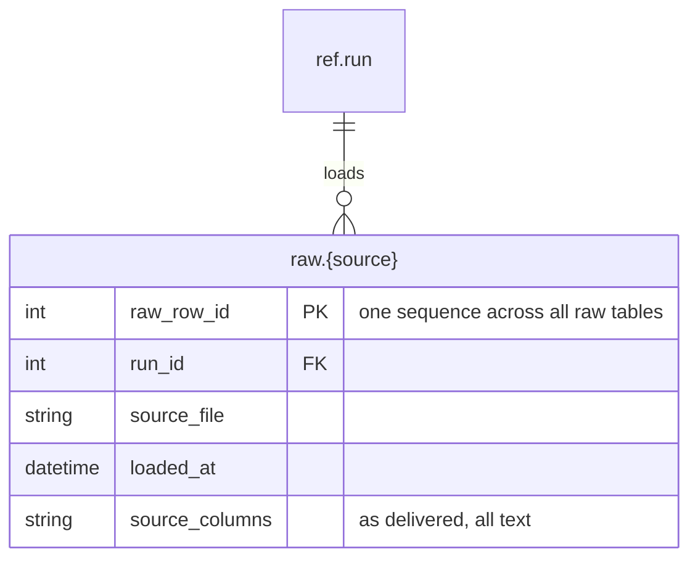

# 03 Raw data

Stage 1. Client data is loaded into `raw` as delivered, every column as text. Raw tables mirror each client's files, so only their shared shape is shown: one table per file type (`raw.claim_file`, `raw.timesheet`, `raw.person`), each with the same load columns.

Every raw table takes `raw_row_id` from one shared sequence, so a `raw_row_id` identifies a single row across all raw tables. That is what the lineage tables in [04 Modelled data](04-modelled-data.md) point at.

Each raw table is registered in `ref.source_table_registry` with `schema_name = raw`, which is how the archive step knows to copy it.

[Back to the README](../README.md)
