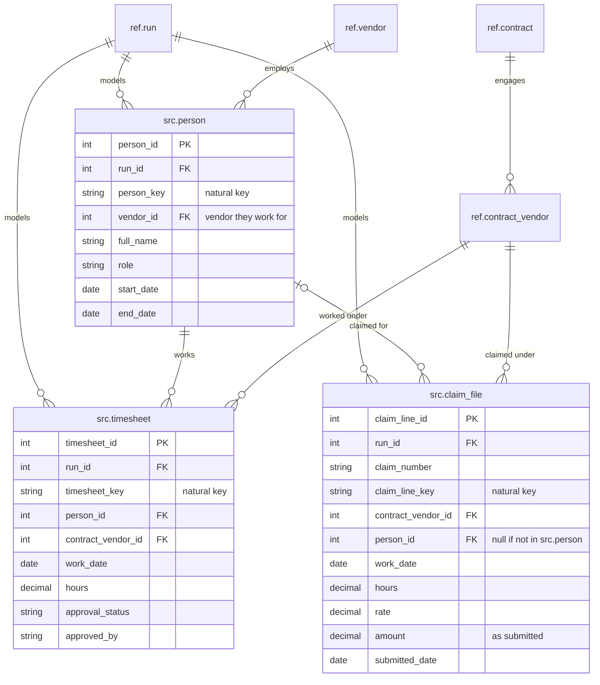

# 04 Modelled data

Stage 2. Raw data is cleaned, typed and keyed into the modelled `src` tables that tests read from. Every row carries `run_id` and the client's natural key.

| Table | Grain |
| --- | --- |
| `src.person` | One row per person per run |
| `src.timesheet` | One row per `person_id`, `contract_vendor_id` and `work_date` |
| `src.claim_file` | One row per claim line; header fields repeat on each line |

Each table is unique on `run_id` + its natural key. Claim lines match timesheets on `person_id` + `contract_vendor_id` + `work_date` within a run. A claim line naming someone not in `src.person` is kept with a null `person_id`, because that is a finding, not a load error. `src.person.vendor_id` and a timesheet's `contract_vendor_id` can disagree; testing for that is a finding, not a constraint.

Each `src` table is registered in `ref.source_table_registry`, which catalogues tables rather than rows, so it has no key to these tables.

[Back to the README](../README.md)
