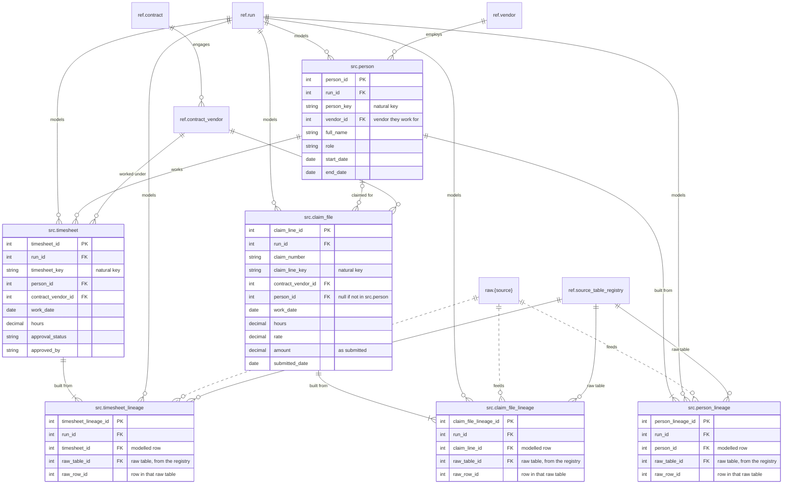

# 04 Modelled data

Stage 2. Raw data is cleaned, typed and keyed into the modelled `src` tables that tests read from. Every row carries `run_id` and the client's natural key, and every modelled row is linked to the raw rows it was built from. Solid lines are enforced foreign keys. Dashed lines are logical links that are not enforced: the raw end of the lineage, and everything in `archive`.

| Table | Grain |
| --- | --- |
| `src.person` | One row per person per run |
| `src.timesheet` | One row per `person_id`, `contract_vendor_id` and `work_date` |
| `src.claim_file` | One row per claim line; header fields repeat on each line |
| `src.{entity}_lineage` | One row per modelled row and raw row it was built from |

Each table is unique on `run_id` + its natural key. Claim lines match timesheets on `person_id` + `contract_vendor_id` + `work_date` within a run. A claim line naming someone not in `src.person` is kept with a null `person_id`, because that is a finding, not a load error. `src.person.vendor_id` and a timesheet's `contract_vendor_id` can disagree; testing for that is a finding, not a constraint.

**Lineage.** Modelling isn't always one raw row to one modelled row: duplicates merge, and one raw row can feed several tables (a timesheet export can also supply people). So each `src` table has a lineage bridge with one row per raw row behind each modelled row. `raw_table_id` says which raw table, from the registry, and `raw_row_id` says which row. The link to the raw row isn't an enforced key, because one column points into whichever raw table `raw_table_id` names; `raw_row_id` still identifies exactly one raw row, because all raw tables share one sequence.

[Back to the README](../README.md)
