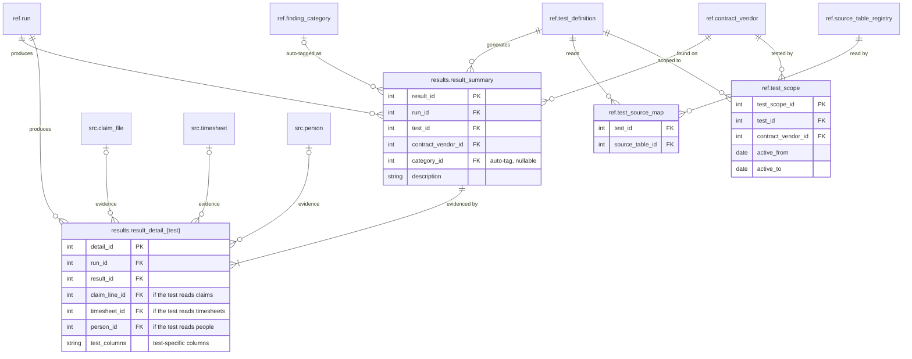

# 05 Testing

Stage 3. For each row in `ref.test_scope` active at the run's `period_end`, the test's logic reads its `src` tables for that vendor on that contract. It writes one `result_summary` row per finding, and one or more rows in its `result_detail_{test}` table that point at the `src` rows behind the finding.

Every finding has at least one detail row. Each detail table has a foreign key column for every `src` table its test reads: a claim-versus-timesheet test carries `claim_line_id` and `timesheet_id`, and a test that only reads claims carries `claim_line_id`. A finding about two duplicate claim lines has two detail rows. A detail table carries only the keys for the tables its test reads; the three shown are the full set for the current sources.

Results are calculated only. `category_id` is set when the test logic can auto-tag a finding and left null otherwise. Reviewers never edit `results`; their decisions go to `validation`.

[Back to the README](../README.md)
