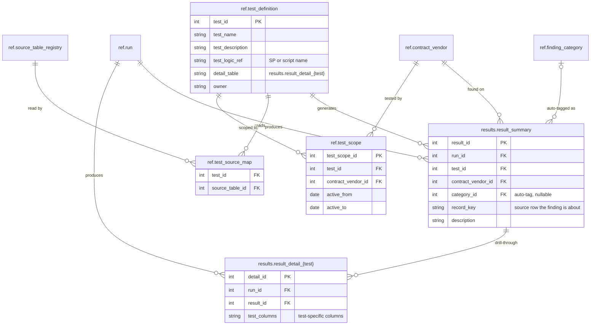

# 05 Testing

Stage 3. For each row in `ref.test_scope` active at the run's `period_end`, the test's logic reads its `src` tables for that vendor on that contract and writes one `result_summary` row per finding, plus test-specific columns in its `result_detail_{test}` table.

Results are calculated only. `category_id` is set when the test logic can auto-tag a finding and left null otherwise. Reviewers never edit `results`; their decisions go to `validation`.

[Back to the README](../README.md)
