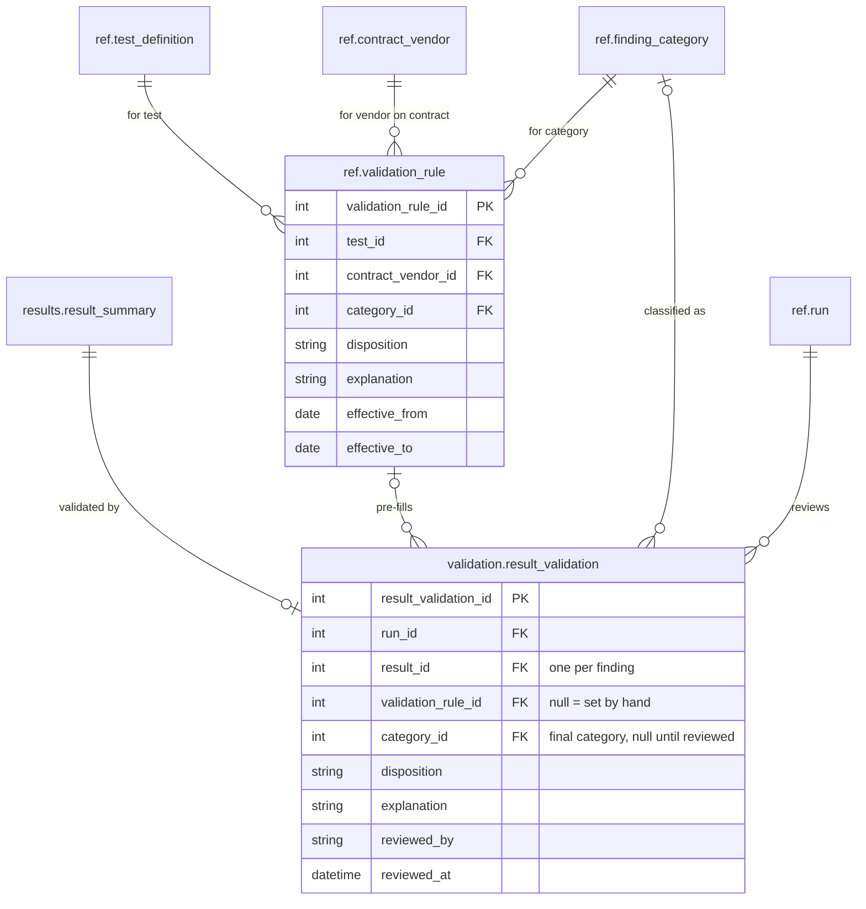

# 06 Validation

Stage 4. When a run moves to `validating`, every finding gets one `result_validation` row. If a `validation_rule` matches the finding's test, vendor on contract and auto-tagged category, effective at the run's `period_end`, it pre-fills the category, disposition and explanation. Reviewers accept or change each one.

A finding with no category never matches a rule, so a new test's first run is reviewed by hand. `validation_rule_id` records where a disposition came from: null means a reviewer set it.

[Back to the README](../README.md)
