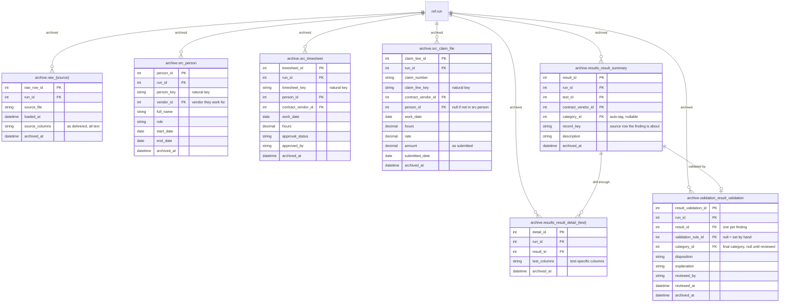

# 07 Archive

Stage 5. When every finding has a disposition, the archive step appends each live table to its `archive` copy in one transaction, sets the run to `finalised` and clears the live tables. Archive copies have the live columns plus `archived_at`. Their `FK` columns are not enforced, because the live rows they pointed at are cleared. Sequence-based keys stay unique across runs, so archive keys never collide.

Power BI reads the reporting views, never the tables directly. Each view is the live table `UNION ALL` its archive copy:

| View | Unions |
| --- | --- |
| `archive.v_result_summary` | `results.result_summary` + `archive.results_result_summary` |
| `archive.v_result_detail_{test}` | `results.result_detail_{test}` + `archive.results_result_detail_{test}` |
| `archive.v_result_validation` | `validation.result_validation` + `archive.validation_result_validation` |
| `archive.v_{entity}` | `src.{entity}` + `archive.src_{entity}` |

The views sit in `archive` because they are mostly archive data, even though each also reads the live table.

[Back to the README](../README.md)
