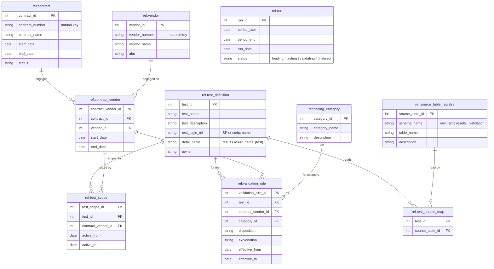

# Lifecycle 1. Run created

A new row in `ref.run` with status `loading`. Everything else in `ref` is already set up from earlier runs (contracts, vendors, tests, scope, categories, rules), but no per-run table holds data yet, so the `ref` tables hang unused. New tables are shown with columns; tables from earlier steps by name only.

**New at this step:** no new tables, just a new `ref.run` row.

**Run status:** `loading`.

[Next: 2. Raw data loaded](02-raw-data.md)

[Back to the README](../../README.md)
