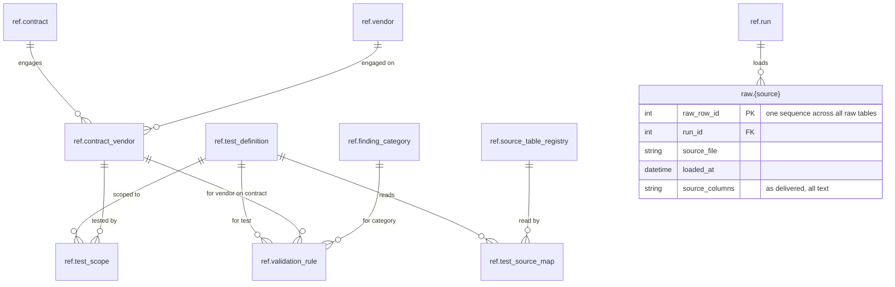

# Lifecycle 2. Raw data loaded

Client files land in `raw`, one table per file type, every row stamped with `run_id`. `ref.run` and `ref.source_table_registry` (which lists the raw tables to load) are the only `ref` tables in use. New tables are shown with columns; tables from earlier steps by name only.

**New at this step:** `raw.{source}`.

**Run status:** `loading`.

[Previous: 1. Run created](01-run-created.md) · [Next: 3. Modelled data](03-modelled-data.md)

[Back to the README](../../README.md)
