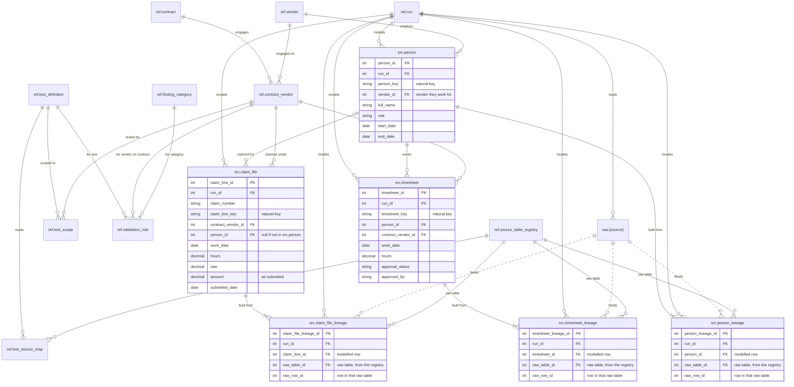

# Lifecycle 3. Modelled data

Raw rows are modelled into `src`, with a lineage row for every raw row behind each modelled row. `ref.vendor` and `ref.contract_vendor` (and through it `ref.contract`) fold in, and the registry now also identifies each lineage row's raw table. When modelling finishes, the run moves to `testing`. New tables are shown with columns; tables from earlier steps by name only.

**New at this step:** `src.person`, `src.timesheet`, `src.claim_file`, `src.person_lineage`, `src.timesheet_lineage`, `src.claim_file_lineage`.

**Run status:** `loading`, then `testing`.

[Previous: 2. Raw data loaded](02-raw-data.md) · [Next: 4. Testing](04-testing.md)

[Back to the README](../../README.md)
