# Lifecycle 5. Validation

Every finding gets a `result_validation` row, pre-filled from `ref.validation_rule` where a rule matches, then reviewed. This is the last `ref` table to fold in: the whole live model is now in use. New tables are shown with columns; tables from earlier steps by name only.

```mermaid
erDiagram
  REF_CONTRACT ||--o{ REF_CONTRACT_VENDOR : "engages"
  REF_VENDOR ||--o{ REF_CONTRACT_VENDOR : "engaged on"
  REF_TEST_DEFINITION ||--o{ REF_TEST_SOURCE_MAP : "reads"
  REF_SOURCE_TABLE_REGISTRY ||--o{ REF_TEST_SOURCE_MAP : "read by"
  REF_TEST_DEFINITION ||--o{ REF_TEST_SCOPE : "scoped to"
  REF_CONTRACT_VENDOR ||--o{ REF_TEST_SCOPE : "tested by"
  REF_TEST_DEFINITION ||--o{ REF_VALIDATION_RULE : "for test"
  REF_CONTRACT_VENDOR ||--o{ REF_VALIDATION_RULE : "for vendor on contract"
  REF_FINDING_CATEGORY ||--o{ REF_VALIDATION_RULE : "for category"
  REF_RUN ||--o{ RAW_SOURCE : "loads"
  REF_RUN ||--o{ SRC_PERSON : "models"
  REF_RUN ||--o{ SRC_TIMESHEET : "models"
  REF_RUN ||--o{ SRC_CLAIM_FILE : "models"
  REF_VENDOR ||--o{ SRC_PERSON : "employs"
  SRC_PERSON ||--o{ SRC_TIMESHEET : "works"
  SRC_PERSON |o--o{ SRC_CLAIM_FILE : "claimed for"
  REF_CONTRACT_VENDOR ||--o{ SRC_TIMESHEET : "worked under"
  REF_CONTRACT_VENDOR ||--o{ SRC_CLAIM_FILE : "claimed under"
  SRC_PERSON ||--|{ SRC_PERSON_LINEAGE : "built from"
  SRC_TIMESHEET ||--|{ SRC_TIMESHEET_LINEAGE : "built from"
  SRC_CLAIM_FILE ||--|{ SRC_CLAIM_FILE_LINEAGE : "built from"
  REF_RUN ||--o{ SRC_PERSON_LINEAGE : "models"
  REF_RUN ||--o{ SRC_TIMESHEET_LINEAGE : "models"
  REF_RUN ||--o{ SRC_CLAIM_FILE_LINEAGE : "models"
  RAW_SOURCE ||..o{ SRC_PERSON_LINEAGE : "feeds"
  RAW_SOURCE ||..o{ SRC_TIMESHEET_LINEAGE : "feeds"
  RAW_SOURCE ||..o{ SRC_CLAIM_FILE_LINEAGE : "feeds"
  REF_SOURCE_TABLE_REGISTRY ||--o{ SRC_PERSON_LINEAGE : "raw table"
  REF_SOURCE_TABLE_REGISTRY ||--o{ SRC_TIMESHEET_LINEAGE : "raw table"
  REF_SOURCE_TABLE_REGISTRY ||--o{ SRC_CLAIM_FILE_LINEAGE : "raw table"
  REF_RUN ||--o{ RES_RESULT_SUMMARY : "produces"
  REF_TEST_DEFINITION ||--o{ RES_RESULT_SUMMARY : "generates"
  REF_CONTRACT_VENDOR ||--o{ RES_RESULT_SUMMARY : "found on"
  REF_FINDING_CATEGORY |o--o{ RES_RESULT_SUMMARY : "auto-tagged as"
  RES_RESULT_SUMMARY ||--|{ RES_RESULT_DETAIL : "evidenced by"
  REF_RUN ||--o{ RES_RESULT_DETAIL : "produces"
  SRC_CLAIM_FILE |o--o{ RES_RESULT_DETAIL : "evidence"
  SRC_TIMESHEET |o--o{ RES_RESULT_DETAIL : "evidence"
  SRC_PERSON |o--o{ RES_RESULT_DETAIL : "evidence"
  RES_RESULT_SUMMARY ||--o| VAL_RESULT_VALIDATION : "validated by"
  REF_VALIDATION_RULE |o--o{ VAL_RESULT_VALIDATION : "pre-fills"
  REF_FINDING_CATEGORY |o--o{ VAL_RESULT_VALIDATION : "classified as"
  REF_RUN ||--o{ VAL_RESULT_VALIDATION : "reviews"

  REF_RUN["ref.run"]
  REF_CONTRACT["ref.contract"]
  REF_VENDOR["ref.vendor"]
  REF_CONTRACT_VENDOR["ref.contract_vendor"]
  REF_SOURCE_TABLE_REGISTRY["ref.source_table_registry"]
  REF_TEST_DEFINITION["ref.test_definition"]
  REF_TEST_SOURCE_MAP["ref.test_source_map"]
  REF_TEST_SCOPE["ref.test_scope"]
  REF_FINDING_CATEGORY["ref.finding_category"]
  REF_VALIDATION_RULE["ref.validation_rule"]
  RAW_SOURCE["raw.{source}"]
  SRC_PERSON["src.person"]
  SRC_TIMESHEET["src.timesheet"]
  SRC_CLAIM_FILE["src.claim_file"]
  SRC_PERSON_LINEAGE["src.person_lineage"]
  SRC_TIMESHEET_LINEAGE["src.timesheet_lineage"]
  SRC_CLAIM_FILE_LINEAGE["src.claim_file_lineage"]
  RES_RESULT_SUMMARY["results.result_summary"]
  RES_RESULT_DETAIL["results.result_detail_{test}"]
  VAL_RESULT_VALIDATION["validation.result_validation"] {
    int result_validation_id PK
    int run_id FK
    int result_id FK "one per finding"
    int validation_rule_id FK "null = set by hand"
    int category_id FK "final category, null until reviewed"
    string disposition
    string explanation
    string reviewed_by
    datetime reviewed_at
  }
```

**New at this step:** `validation.result_validation`.

**Run status:** `validating`.

[Previous: 4. Testing](04-testing.md) · [Next: 6. Archive](06-archive.md)

[Back to the README](../../README.md)
